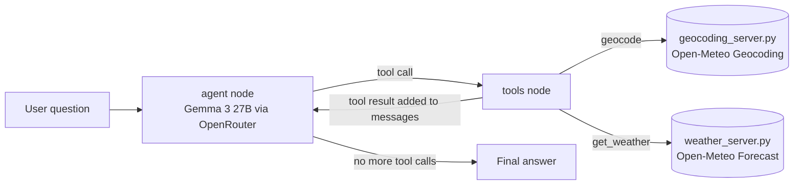

# TinyLlama Medical LoRA + MCP Weather Agent

Two small, self-contained projects built for Week 12 of **IE 7722 Agentic AI Systems (LSU, Fall 2026)**:

| Folder | What it does |
|---|---|
| [`lora_finetuning/`](lora_finetuning/) | Fine-tunes **TinyLlama-1.1B-Chat** on the **Medical Meadow flashcards** with LoRA, then evaluates it against the un-finetuned model (loss, accuracy, ROUGE-L, BERTScore, NLI-based hallucination, out-of-dataset generalization). |
| [`mcp_weather_agent/`](mcp_weather_agent/) | A **LangChain + LangGraph** agent that answers weather questions by calling two **MCP servers** in turn: Open-Meteo geocoding (city → lat/lon), then Open-Meteo forecast (lat/lon → conditions). |

The companion project (knowledge-graph extraction into Neo4j + graph RAG) lives in
[neo4j-knowledge-graph-rag](https://github.com/SAeidch/neo4j-knowledge-graph-rag).

> **Not medical advice.** The fine-tuned model is a 1.1B-parameter research artifact. Its answers are not reviewed by clinicians and must not be used for medical decisions.

---

## 1. LoRA fine-tuning (`lora_finetuning/`)

| File | Role |
|---|---|
| `train_lora.py` | Downloads and cleans the dataset, builds chat-template prompts, applies LoRA, trains with a 90/10 split, saves the adapter and metrics to `runs/<config>/`. |
| `evaluate_lora.py` | Scores the base model and every trained configuration on four question sets; writes `runs/eval/results.md`, `results.json`, predictions and examples. |
| `lora_common.py` | One shared prompt format and tokenizer setup, so training and testing see identical text. |
| `run_all.ps1` | Trains the three configurations and evaluates them in one go. |

### Setup

```powershell
cd lora_finetuning
python -m venv .venv; .\.venv\Scripts\Activate.ps1
# Install a CUDA build of PyTorch first (https://pytorch.org/get-started/locally/);
# a plain "pip install torch" on Windows gives a CPU-only build that is far too slow.
pip install -r requirements.txt
```

### Run

```powershell
# Quick smoke test (minutes)
python train_lora.py --config baseline --max-samples 200 --epochs 1

# Full experiment used for the results below (10,000 records, 3 configs, then evaluation)
.\run_all.ps1 -Samples 10000
```

Use the same `--max-samples` for every configuration so they share one train/validation split.
Lighter evaluation options: `--bertscore-model distilbert-base-uncased`, `--max-eval-samples 100`, `--no-bertscore`, `--no-nli`.

### Method

- **Data:** `medalpaca/medical_meadow_medical_flashcards` (33,955 records → 33,520 after removing 408 empty questions and 27 duplicates). Random 10,000-record subset (seed 42), split 9,000 train / 1,000 validation.
- **Prompt:** TinyLlama's own chat template with a fixed system message; loss is computed on answer tokens only (prompt tokens masked).
- **LoRA:** adapters on `q_proj`, `k_proj`, `v_proj`, `o_proj` of all 22 layers, dropout 0.05; base weights frozen in bfloat16.
- **Training:** HF `Trainer`, AdamW, cosine schedule with 3% warm-up, effective batch 8 (2 × 4 accumulation), 3 epochs, max length 512. Hardware: RTX 4060 8 GB (the rank16 run took ~90 min).

| Config | LoRA rank | Alpha | Learning rate | Trainable params |
|---|---|---|---|---|
| `baseline` (assignment default) | 8 | 16 | 2e-4 | 2.25 M (0.20%) |
| `rank16` | 16 | 32 | 2e-4 | 4.51 M (0.41%) |
| `highlr` | 8 | 16 | 5e-4 | 2.25 M (0.20%) |

### Results

**Loss** (validation loss recomputed identically for all models on 200 held-out questions)

| Model | Final train loss | Val loss | Val perplexity |
|---|---|---|---|
| base (no fine-tuning) | – | 0.975 | 2.65 |
| baseline | 0.716 | 0.770 | 2.16 |
| rank16 | 0.653 | 0.769 | 2.16 |
| highlr | 0.617 | 0.778 | 2.18 |

**Held-out flashcard questions (n = 200)**

| Model | Accuracy | ROUGE-L | BERTScore F1 | Hallucination rate | Avg. words |
|---|---|---|---|---|---|
| base | 0.460 | 0.284 | 0.886 | 0.820 | 64.7 |
| baseline | 0.435 | 0.404 | 0.913 | 0.685 | 30.4 |
| rank16 | 0.435 | 0.405 | 0.912 | 0.700 | 30.2 |
| highlr | 0.440 | 0.401 | 0.912 | 0.675 | 32.9 |

**Generalization: 30 hand-written medical questions not in the dataset**

| Model | Accuracy | ROUGE-L | BERTScore F1 | Hallucination rate | Avg. words |
|---|---|---|---|---|---|
| base | 0.500 | 0.116 | 0.856 | 0.567 | 36.1 |
| baseline | 0.567 | 0.208 | 0.882 | 0.433 | 14.8 |
| rank16 | 0.633 | 0.230 | 0.886 | 0.367 | 14.5 |
| highlr | 0.500 | 0.199 | 0.879 | 0.400 | 15.2 |

Hallucination rate = share of answers an NLI model (`cross-encoder/nli-deberta-v3-small`) does not judge consistent with the reference answer. All quality metrics are automatic proxies, not expert review.

### Takeaways

- LoRA cut validation loss by ~20% (0.975 → ~0.77) and made answers shorter and closer to the references (ROUGE-L 0.28 → 0.40).
- Keyword accuracy did **not** improve on held-out flashcards; most of the gain is style and format, not new medical knowledge.
- The three configurations are statistically tied. `highlr` has the lowest training loss but the highest validation loss, a hint of overfitting. The baseline is sufficient.
- Each configuration was trained once; differences of a few questions (3.3 points each on the 30-question set) are noise.

---

## 2. MCP weather agent (`mcp_weather_agent/`)



| File | Role |
|---|---|
| `weather_agent.py` | LangGraph `StateGraph` (agent ⇄ tools loop, recursion limit 12), loads MCP tools via `langchain-mcp-adapters`, logs every MCP call/response to `agent_log.txt`. |
| `geocoding_server.py` | MCP server (FastMCP, stdio): `geocode(city, country_code?)` → up to 5 matches with lat/lon. |
| `weather_server.py` | MCP server (FastMCP, stdio): `get_weather(latitude, longitude, temperature_unit, forecast_days)` → current conditions + daily forecast. |

Both Open-Meteo APIs are free for non-commercial use and need **no API key**. Only the LLM needs one.

### Setup

```powershell
cd mcp_weather_agent
python -m venv .venv; .\.venv\Scripts\Activate.ps1
pip install -r requirements.txt
$env:OPENROUTER_API_KEY = "<your key>"   # set in the shell; never put it in code or commit it
```

### Run

```powershell
python weather_agent.py --mode react --model google/gemma-3-27b-it "Will I need an umbrella in Seattle in the next three days?"
python weather_agent.py --mode react      # interactive
```

Any OpenAI-compatible endpoint works: `--base-url <url> --key-env <ENV_VAR_NAME> --model <id>`.

**Tool-calling modes.** `native` uses the provider's function-calling API. Gemma 3 called the first tool correctly but then returned empty replies on the tool-result turn, so a `react` mode was added: tools are described in the prompt, the model replies with a JSON line such as `{"tool": "geocode", "args": {"city": "Paris"}}`, and the program turns it into a normal tool call for the same LangGraph loop. All examples below used `react`.

### Example runs (Gemma 3 27B, `react` mode, November 2026)

| Question | MCP calls | LLM requests | Outcome |
|---|---|---|---|
| What's the weather in Boston? | geocode → get_weather (°F) | 3 | Correct |
| Will I need an umbrella in Seattle in the next three days? | geocode → get_weather (3 days) | 3 | Correct |
| How hot is it in Tokyo right now? | geocode → get_weather (°C) | 3 | Correct |
| What's the weather in Atlantis? | geocode → get_weather | 3 | Picked Atlantis, South Africa (first of 5 real matches); called "today" "tomorrow" |
| What's the weather like in Paris, Texas? | geocode (country US) → get_weather | 3 | Correct |
| What is the capital of France? | none | 1 | Correct: no tools used |

---

## Security

- **No credentials are stored in this repository.** The OpenRouter key is read from an environment variable at run time (`--key-env` picks which one).
- `.gitignore` blocks `.env*`, key files, run logs (`agent_log.txt`), training outputs (`runs/`, `*.safetensors`) and Office documents.
- If you fork this, keep keys in environment variables or a local `.env` that stays untracked. Rotate any key that is ever committed by mistake, even if you delete the commit afterward.
